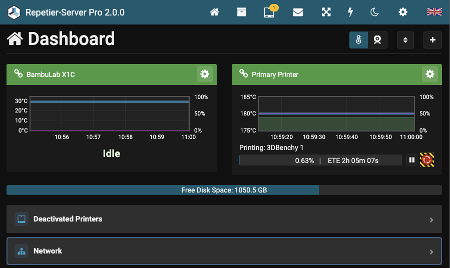
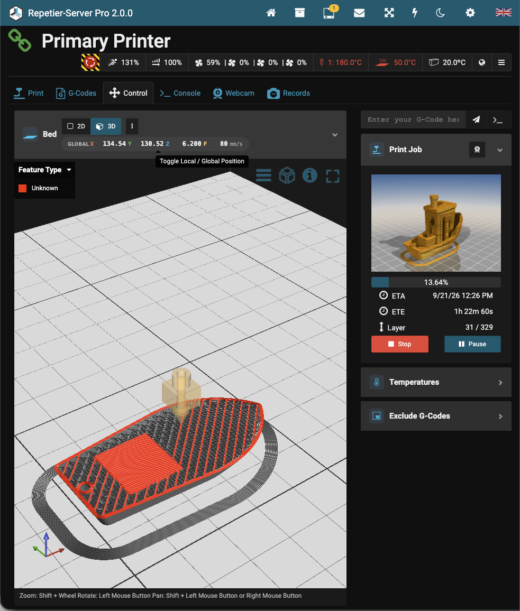
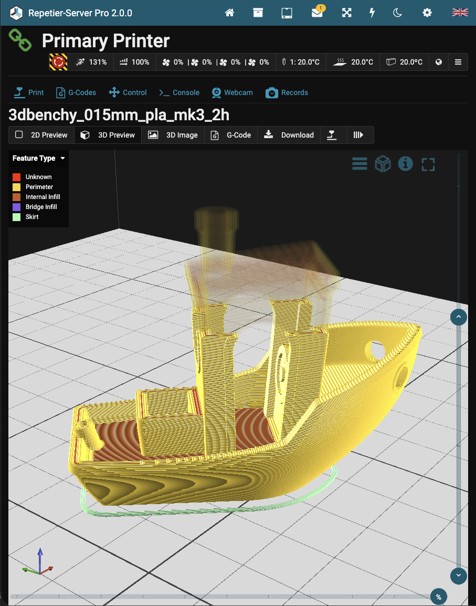
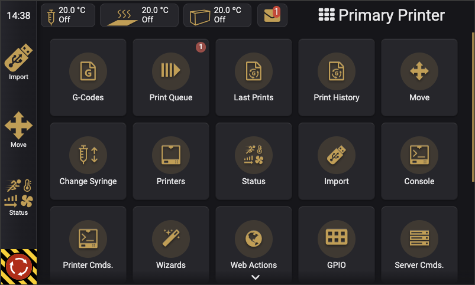
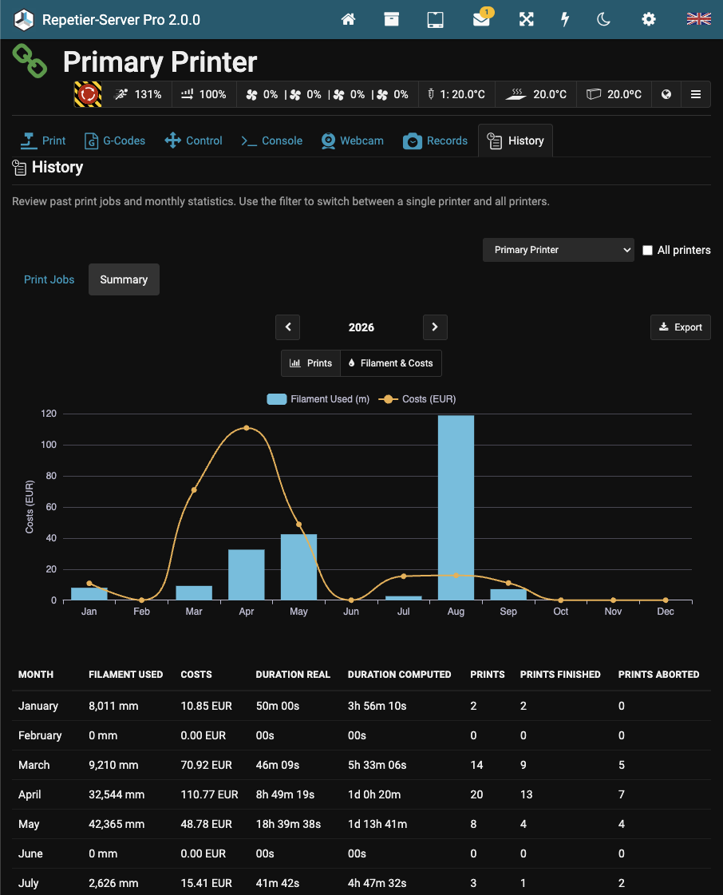

<!--
  IMAGE TODO: Place the logo at docs/images/logo.png (about 400 px wide, transparent background).
  The original is at https://www.repetier-server.com/en/wp-content/uploads/2020/04/logo-repetier-server.png
-->
<p align="center">
  
</p>

<p align="center">
  <strong>Control your 3D printers from everywhere – anytime.</strong>
</p>

<p align="center">
  <a href="https://github.com/repetier/Repetier-Server/releases/latest"></a>
  <a href="https://github.com/repetier/Repetier-Server/releases"></a>
  
  
</p>

<p align="center">
  <a href="#download">Download</a> ·
  <a href="#free-for-everyone">Free for everyone</a> ·
  <a href="#features">Features</a> ·
  <a href="#installation">Installation</a> ·
  <a href="#support-and-bug-reports">Bug reports</a> ·
  <a href="#legal">Legal</a>
</p>

> [!IMPORTANT]
> **Development of Repetier-Server has been discontinued.**
>
> This repository is the official archive and download location for Repetier-Server. It contains
> the installers only, not the source code.
>
> - **Repetier-Server 2.0.0 is free for everyone** – for personal and commercial use, with all
>   features and without a license key.
> - We may publish one or two bug-fix releases if serious bugs are reported. After that, there
>   will be no further development.
> - The automatic update check and the Repetier-Informer push service will be switched off on
>   **30 June 2027**. Repetier-Server itself keeps working after that date.

<!--
  IMAGE TODO: hero.png or hero.gif – the dashboard with two or three printers, one of them printing.
  A short animated GIF (10–15 s) that clicks through dashboard → printer → webcam works well here.
-->
<p align="center">
  
</p>

## Download

The latest version is **Repetier-Server 2.0.0**. All files are attached to the
[latest release](https://github.com/repetier/Repetier-Server/releases/latest).

<!-- Update the version in the file names and links below with every new release. -->

| Platform                   | File                                                 | Requirements                              |
| -------------------------- | ---------------------------------------------------- | ----------------------------------------- |
| Windows (64-bit Intel/AMD) | [Repetier-Server-2.0.0-windows-x64.exe][win-x64]     | Windows 10 or 11                          |
| Windows (ARM)              | [Repetier-Server-2.0.0-windows-arm64.exe][win-arm64] | Windows 11 on ARM                         |
| macOS (Apple Silicon)      | [Repetier-Server-2.0.0-macos-arm64.pkg][mac-arm64]   | macOS 12 Monterey or later                |
| macOS (Intel)              | [Repetier-Server-2.0.0-macos-x64.pkg][mac-x64]       | macOS 12 Monterey or later                |
| Linux 64-bit Intel/AMD     | [Repetier-Server-2.0.0-linux-amd64.deb][linux-amd64] | Debian, Ubuntu or another Debian-based OS |
| Linux 64-bit ARM           | [Repetier-Server-2.0.0-linux-arm64.deb][linux-arm64] | Debian, Ubuntu or another Debian-based OS |
| Linux 32-bit ARM (armhf)   | [Repetier-Server-2.0.0-linux-armhf.deb][linux-armhf] | Debian, Ubuntu or another Debian-based OS |
| Linux 32-bit ARM (armel)   | [Repetier-Server-2.0.0-linux-armel.deb][linux-armel] | Debian, Ubuntu or another Debian-based OS |
| Linux 32-bit Intel         | [Repetier-Server-2.0.0-linux-i386.deb][linux-i386]   | Debian, Ubuntu or another Debian-based OS |

<!-- TODO: Check the minimum Windows, macOS and glibc versions against the actual 2.0.0 builds. -->

Each release also contains a `SHA256SUMS.txt` file so you can verify your download.

[win-x64]: https://github.com/repetier/Repetier-Server/releases/download/v2.0.0/Repetier-Server-2.0.0-windows-x64.exe
[win-arm64]: https://github.com/repetier/Repetier-Server/releases/download/v2.0.0/Repetier-Server-2.0.0-windows-arm64.exe
[mac-arm64]: https://github.com/repetier/Repetier-Server/releases/download/v2.0.0/Repetier-Server-2.0.0-macos-arm64.pkg
[mac-x64]: https://github.com/repetier/Repetier-Server/releases/download/v2.0.0/Repetier-Server-2.0.0-macos-x64.pkg
[linux-amd64]: https://github.com/repetier/Repetier-Server/releases/download/v2.0.0/Repetier-Server-2.0.0-linux-amd64.deb
[linux-arm64]: https://github.com/repetier/Repetier-Server/releases/download/v2.0.0/Repetier-Server-2.0.0-linux-arm64.deb
[linux-armhf]: https://github.com/repetier/Repetier-Server/releases/download/v2.0.0/Repetier-Server-2.0.0-linux-armhf.deb
[linux-armel]: https://github.com/repetier/Repetier-Server/releases/download/v2.0.0/Repetier-Server-2.0.0-linux-armel.deb
[linux-i386]: https://github.com/repetier/Repetier-Server/releases/download/v2.0.0/Repetier-Server-2.0.0-linux-i386.deb

### Which Linux package do I need?

Run this command on the target device:

```bash
dpkg --print-architecture
```

| Output  | Package | Typical devices                                             |
| ------- | ------- | ----------------------------------------------------------- |
| `amd64` | amd64   | PCs, mini PCs, Intel NUCs, virtual machines                 |
| `arm64` | arm64   | Raspberry Pi 3/4/5 with a 64-bit OS, most modern ARM boards |
| `armhf` | armhf   | Raspberry Pi 2/3/4 with a 32-bit OS, older ARMv7 boards     |
| `armel` | armel   | Raspberry Pi 1 and Zero (ARMv6)                             |
| `i386`  | i386    | Old 32-bit PCs                                              |

Older 1.x versions are not published here. Version 2.0.0 includes everything the old Pro version
offered, without a license key.

## Free for everyone

Up to version 1.x, Repetier-Server was sold in Free, Lite and Pro editions, and many features
required a paid license key. **Starting with version 2.0.0, every feature is unlocked for
everyone.**

- No license key, no registration, no activation.
- Free for personal and commercial use, on as many computers as you like.
- You may copy and pass on unmodified installers.
- Your right to use the software stays valid after support and online services have ended
  (see [EULA § 1](LICENSE.md#-1-license)).

If you bought a license in the past: thank you! You helped make this project possible. You no longer
need the key with version 2.0.0.

## Features

Repetier-Server runs on a PC, Mac, Linux server or a small board like a Raspberry Pi. It connects
to your 3D printers and gives you a web interface you can open in any browser, from anywhere in
your network or through a secured external connection.

- **Many printers, one interface** – run and monitor several printers at the same time.
- **Wide printer support** – Marlin, RepRap, Repetier firmware, Klipper and Bambu Lab
  printers (beta).
- **Print queue and G-code management** – upload jobs, organize them in folders and start them
  from anywhere.
- **Webcams and timelapse** – many webcam types and sources, with timelapse recordings of your
  prints.
- **3D G-code preview** and print time prediction.
- **Print history and reports** – statistics, costs and PDF reports per print.
- **Touch interface** for displays attached directly to the printer host.
- **Maintenance and notes** – per-printer maintenance tasks, to-dos and important notes.
- **Automation** – computed expressions, server commands such as `@foreach`, and custom scripts
  on events.
- **Smart home integration** – Home Assistant discovery, MQTT, ioBroker, Pushover and IFTTT.
- **GPIO control** on Linux boards, for example for lights, relays or emergency buttons.
- **Log viewer** for printer and server logs in the user interface.
- **User accounts** with permissions and API keys.

## Screenshots

<!--
  IMAGE TODO: Put the screenshots in docs/images/ and remove the comment markers around each image.
  Recommended: PNG, 1600 px wide, light theme, realistic demo data (printer names, job names).

  1. dashboard.png         – Overview with several printers in different states (idle, printing, error).
  2. printer-control.png   – Single printer during a print: temperatures chart, progress, manual control.
  3. webcam-timelapse.png  – Webcam view next to the print, or the timelapse list.
  4. gcode-preview.png     – 3D G-code preview of a colorful model, ideally mid-print with layer slider.
  5. touch-ui.png          – Touch interface on a 7" display (a photo of the real display also works well).
  6. printer-types.png     – "Add printer" wizard showing Klipper, Bambu Lab and serial firmware options.
  7. history-report.png    – Print history with statistics, or a generated PDF report.
  8. maintenance.png       – Maintenance tasks and per-printer notes.
-->

### Printer control



### 3D G-code preview



### Touch interface



### Print history



## Installation

### Windows

1. Download the `.exe` installer for your system.
2. Run the installer and follow the steps.
3. Open <http://localhost:3344> in your browser.

### macOS

1. Download the `.pkg` for your Mac (Apple Silicon or Intel).
2. Open the package and follow the steps.
3. Open <http://localhost:3344> in your browser.

### Linux

Download the matching `.deb` package and install it with `apt`, which also installs missing
dependencies:

```bash
sudo apt install ./Repetier-Server-2.0.0-linux-arm64.deb
```

Then open `http://<ip-of-your-device>:3344` in your browser.

### Upgrading from 1.x

> [!WARNING]
> Version 2.0.0 uses a new storage format. **Back up your Repetier-Server data before upgrading.**
> If you install an older version again afterwards, a lot of data will be lost.

Install 2.0.0 over your existing installation. If you use Klipper printers, check the new
Klipper settings in the printer configuration after upgrading.

## Support and bug reports

There is **no support** for Repetier-Server anymore.

If you find a serious bug in version 2.0.0, you can
[open an issue](https://github.com/repetier/Repetier-Server/issues/new/choose). We will read the
reports and may publish one or two bug-fix releases, but we cannot promise a fix or an answer.

The documentation remains available on [repetier-server.com](https://www.repetier-server.com)
for as long as the website is online.

The software also provides a manual accessible through the web interface.

## Privacy

Repetier-Server runs on your own hardware and contains **no telemetry, analytics or tracking**.
Your printers, jobs and files never leave your device unless you connect a service yourself.

Until 30 June 2027, the software checks a small file on our update server to see if a new version
is available. After that date, it no longer contacts our servers at all. Details are in the
[privacy policy](PRIVACY.md).

## Legal

| Document                                      | Content                                           |
| --------------------------------------------- | ------------------------------------------------- |
| [End User License Agreement](LICENSE.md)      | The terms under which you may use Repetier-Server |
| [Privacy Policy](PRIVACY.md)                  | Which data Repetier-Server processes              |
| [Third-Party Notices](THIRD-PARTY-NOTICES.md) | Licenses of the open-source components included   |
| [Changelog](CHANGELOG.md)                     | Changes in each release                           |
| [Imprint](IMPRINT.md)                         | Publisher of this repository                      |

Repetier-Server is based on Repetier-Server 0.24, which was released under the Apache License 2.0.
Later versions, including this one, are **not open source**. The installers are free to use and
share under the [EULA](LICENSE.md).

---

<p align="center">
  © 2013–2026 Hot-World GmbH &amp; Co. KG<br>
  Thank you to everyone who printed, tested, translated and supported Repetier-Server over the years.
</p>
