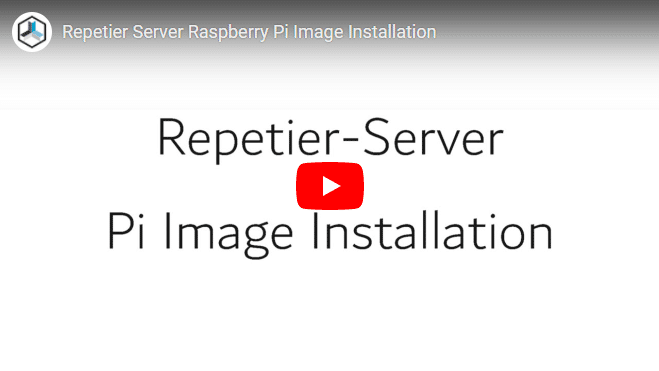
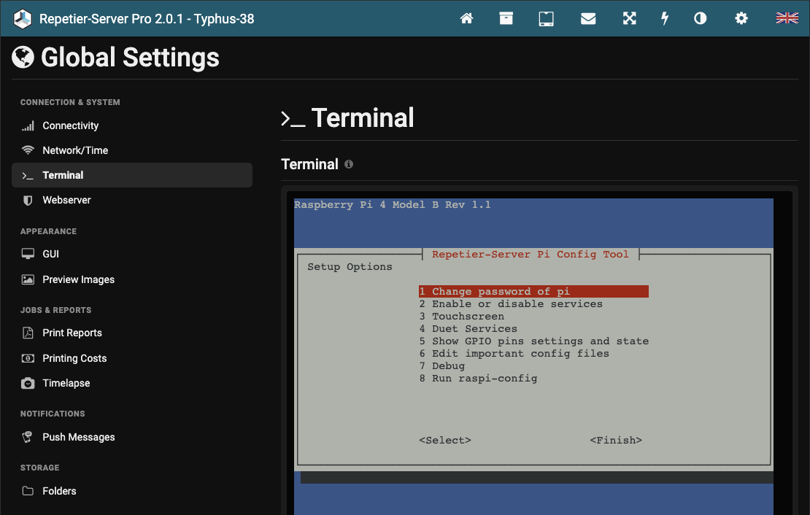
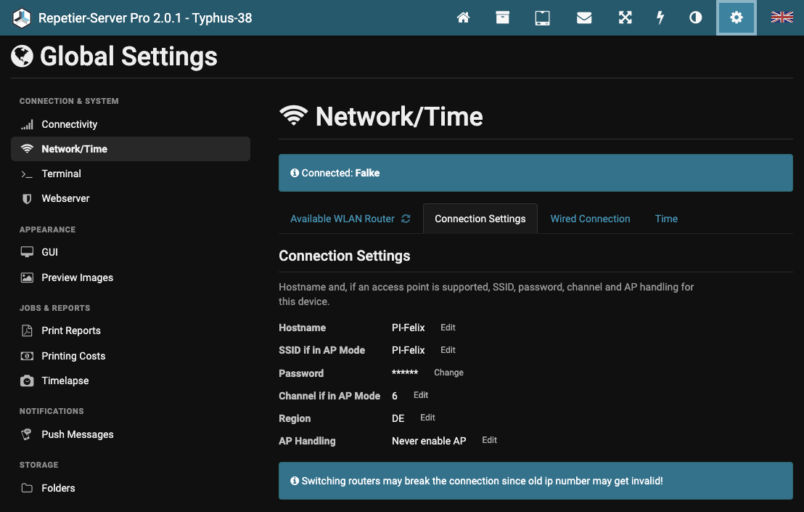
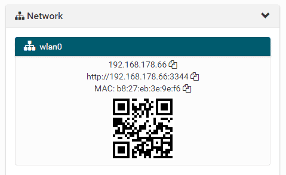
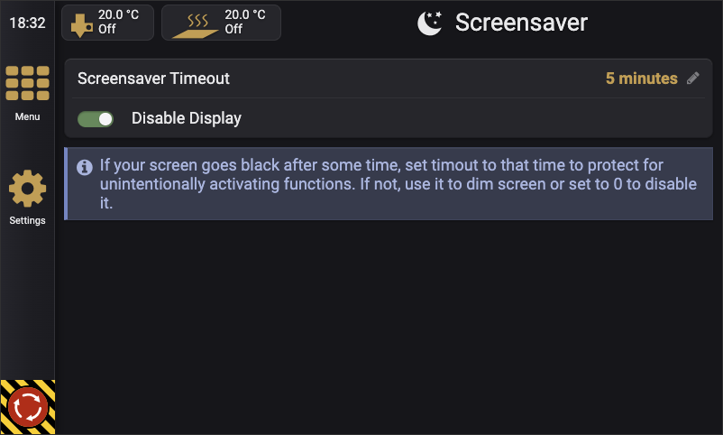

# Raspberry Pi Image

Many users are not familiar with Linux. To make it as easy as possible to run Repetier-Server on a
Raspberry Pi, we provide a ready-to-use SD card image with Repetier-Server, webcam support, a touch
interface and a configuration tool already installed.

## Download

| Image | Repetier-Server | Based on                        | File                                          |
| ----- | --------------- | ------------------------------- | --------------------------------------------- |
| V40   | 2.0.1           | Raspberry Pi OS Trixie (Debian) | [Repetier-Server-Image_2_0_1_v40.img.xz][v40] |

[v40]: https://github.com/repetier/Repetier-Server/releases/download/v2.0.1/Repetier-Server-Image_2_0_1_v40.img.xz

> [!IMPORTANT]
> The image has a default user **repetier** with the password **repetier**. Change the password
> after the installation for security reasons! Images before V40 used the user **pi** with the
> password **raspberry**.

[][video]

[video]: https://www.youtube.com/watch?v=hEN4CPa05UM&list=PLLyonOdASWGB5Sz8jAHtFF-u1o35I9H64

### Power supply

The Raspberry Pi is very sensitive to its power supply. If it does not receive a stable 5 V, you may
see stability issues such as lost connections or temperature errors. Use a solid 3 A power supply,
ideally with 5.1 V output. A cheap USB cable with thin wires can also cause voltage loss. We
recommend an AWG20 USB cable.

## Installing the image

You need an SD card with at least 4 GB. On a 4 GB card only about 2 GB remain free, so a bigger card
is a good idea. We recommend a 32 GB **high endurance** SD card. It is a good compromise between
space and price, and bigger cards last longer because there are more blocks to write to.

There are two simple ways to write the image to the SD card.

### Option 1: Raspberry Pi Imager

1. Download the image from the table above.
2. Download and install the [Raspberry Pi Imager](https://www.raspberrypi.com/software/).
3. Insert the SD card into your computer and start the Raspberry Pi Imager.
4. Select your Raspberry Pi model.
5. As operating system, choose **Use custom** and select the downloaded `.img.xz` file.
6. Select your SD card as storage and write the image.

The Raspberry Pi Imager may offer to apply OS customization settings. Skip this step – the image
configures itself on the first start.

### Option 2: balenaEtcher

1. Download the image from the table above.
2. Download and install [balenaEtcher](https://etcher.balena.io/).
3. Start balenaEtcher and click **Flash from file**. Select the downloaded `.img.xz` file. You do
   not need to unpack it.
4. Select your SD card as target.
5. Click **Flash!** and wait until it has finished.

## First boot and server access

The first start can take a while. The image expands the file system to the size of your SD card and
creates the SSH keys.

Next, a script checks which Raspberry Pi model you are using. On a Raspberry Pi Zero with the ARMv6
architecture, it disables the graphical interface and switches the server to the `armel` version,
because the default `armhf` version cannot run on that processor.

You have several options to access the server after the first start:

- **Ethernet:** If the Pi is connected with a network cable, it gets an IP address from your
  router's DHCP server. Open that IP address in your browser.
- **Wi-Fi access point:** If the Pi has a Wi-Fi adapter with access point support, it switches Wi-Fi
  into access point mode with the SSID `RepetierServer` and the default password `12345678`.
  Connect to this network with a smartphone and open <http://10.10.10.1>, or
  <http://RepetierServer.local> if your device supports Zeroconf. Select your router's network and
  enter its password. The Pi then switches to your network if it is reachable.
- **Manual Wi-Fi configuration:** You can bypass the Wi-Fi configuration of Repetier-Server. If the
  file `/boot/firmware/ManualWifi.conf` exists, it is installed into NetworkManager as Wi-Fi
  configuration, and Repetier-Server no longer changes the Wi-Fi settings. The `/boot/firmware`
  folder is also visible when you insert the SD card into a Windows computer, so you can create the
  file without access to the Pi. Use Unix line endings! The sample file
  `/boot/firmware/ManualWifi.conf.sample` can be copied, customized and renamed.

## Config tool

Most settings of the image can be changed with our interactive Repetier-Server Pi config tool. Start
it with `repetier-setup` on the command line, for example over SSH.

You can also use it from the web interface: open **Global Settings → Terminal** and log in as user
**repetier** with your password (default: **repetier**). The config tool starts automatically. To
get to the shell, just finish the config tool.



## First steps and securing the installation

Your first step should be to secure the installation:

- **Change the login password** of the user **repetier** in the config tool.
- **Secure the access point.** By default, the access point uses the password `12345678`. Either
  disable the access point if you connect with a network cable (the most stable solution), or set
  your own password so no one else can use it to log in. If you run several Repetier-Server
  installations, also give each access point a unique SSID.
- **Add a user in the user manager** of Repetier-Server if your Pi can be reached from outside or by
  people who should not have access.

You may also want to change the host name. On computers that support Zeroconf host names, you can
then always open the interface at `http://<hostname>.local`. Otherwise use the IP address.

To change the host name and to disable the access point mode, go to
**Global Settings → Network/Time** and select **Connection Settings**. Click **Hostname** to change
the host name, and click **AP Handling** and select **Never enable AP** if wanted.



It is a good idea to configure the DHCP server (usually part of your router) to always assign the
same IP address to the Pi. To do this, assign a static IP address to the Pi's MAC address. You find
the MAC address of every network device at the bottom of the dashboard in the web interface. All
routers have this setting in their DHCP configuration, but since every router is different, we
cannot describe the steps for your router here.



Now connect your printer and set it up as described in the manual, which you can open from the web
interface.

## Special cases and troubleshooting

### No display

If no screen is connected to your Pi, you can disable the graphical interface and the browser. This
reduces CPU and RAM usage. It can also help if your printer sometimes disconnects because of a weak
power supply.

Open the config tool, go to **3 Touchscreen → 1 Touchscreen (Start Touchscreen)** and select
**2 Headless system (less ram and cpu for pi 0)**.

### Rotate the display

Depending on how you mounted the display, you may need to rotate the screen.

Open the config tool and go to **3 Touchscreen → 4 Screen Orientation → OK**. Make sure the screen
saver is not active. A screen layout tool appears on your touchscreen:

1. Select **Layout → Screens → DSI-1 → Orientation** and choose your orientation. To rotate by 180°,
   select **Inverted**.
2. Go to **Layout → Screens → DSI-1 → Touchscreen** and select your touchscreen.
3. Click **Apply**. The change becomes visible, and you have 10 seconds to confirm it with **OK**.
4. Close the program with **Close**.

The boot messages on the text console are not affected by this setting.

If you use the official Raspberry Pi 7″ touchscreen, you can also
[rotate it as described in the Raspberry Pi documentation][rpi-rotate].

[rpi-rotate]: https://www.raspberrypi.com/documentation/accessories/display.html#changing-the-screen-orientation

With some touchscreens, the touch input still uses the original orientation. In that case, edit
`/usr/share/X11/xorg.conf.d/40-libinput.conf` to rotate the touch position. Find the touchscreen
section and add the `TransformationMatrix` option. This example rotates by 180°:

```text
Section "InputClass"
        Identifier "libinput touchscreen catchall"
        MatchIsTouchscreen "on"
        MatchDevicePath "/dev/input/event*"
# If the screen is rotated, transform the touch matrix as shown below:
# 90 degrees
#       Option "TransformationMatrix" "0 1 0 -1 0 1 0 0 1"
# 180 degrees
        Option "TransformationMatrix" "-1 0 1 0 -1 1 0 0 1"
# 270 degrees
#       Option "TransformationMatrix" "0 -1 1 1 0 0 0 0 1"
        Driver "libinput"
EndSection
```

### Scale the display

The touch interface is designed for displays with a normal pixel density. On a display with a higher
density, buttons and fonts may look small. To change the scaling factor of the browser, open the
config tool, select **3 Touchscreen → 6 Touchscreen Scaling**, enter the new factor and confirm with
**OK**.

### Non-HDMI displays

There are many cheap LCD displays that plug directly onto the GPIO header of the Raspberry Pi
instead of using HDMI. Small displays with resolutions up to 480×320 pixels often work this way. The
image is rendered into a frame buffer and sent to the display over SPI. Follow the instructions of
your display vendor to set up the display. After a final reboot, the printer interface starts
automatically.

### Display power saving

In the screen saver settings, you can enable or disable the hardware screen saver, which turns the
display off. Some users report that the display sometimes does not turn on again. This is a function
of Linux/X11 – we only set the timeout with the `xset` command. If this happens to you, disable the
hardware screen saver. The screen still darkens after the timeout, but the backlight is not switched
off.



### Import from a USB stick

The server is preconfigured to import files from a USB stick. Insert a USB stick and it is mounted
automatically. The import function then shows the files on the stick.

### Raspberry Pi Zero W on the printer board

The image also runs on a Raspberry Pi Zero W connected directly to the printer board, for example on
a Prusa MK3 with an Einsy Rambo board.

## Breaking changes

### GPIO

The `wiringpi` library used on older images is deprecated and no longer available. To show the
state of all pins, run `gpioreadall` in the terminal, or open the config tool and select
**5 Show GPIO pins settings and state**.

As a replacement for the `gpio` command, use `raspi-gpio` (not available on the Raspberry Pi 5). Run
`raspi-gpio help` to list the possible parameters. Pins use the BCM numbering scheme!

## Image changelog

<details>
<summary>Show changes of all image versions</summary>

- **V40** Based on Raspberry Pi OS Trixie, Repetier-Server 2.0.1. The default user is now
  **repetier** with the password **repetier**.
- **V38** Bug fixes, SSH support for SHA-1 keys disabled, webcam fixes and updates.
- **V37** Based on Raspberry Pi OS Bookworm, supports the Raspberry Pi 5.
- **V36** Improved `repetier-setup`. Changed the HTTP proxy to HAProxy. HTTPS can be configured in
  the Repetier-Server interface.
- **V35** Improved `repetier-setup`. The file system is only repaired if selected in
  `repetier-setup`, for a faster boot.
- **V34** Improved `repetier-setup`, checks and repairs (if possible) the file system on every
  start, kernel 5.15.76-v7l+.
- **V33** Fixed libcamera blocking the camera list while the streamer is running.
- **V32** Fixed Pi camera for newer libcamera, improved `repetier-setup`.
- **V31** Fixed Pi camera detection and starting the Pi camera when none is present.
- **V30** Based on Raspbian Bullseye, `repetier-setup` command for easy configuration, kernel
  5.15.32-v7l+.
- **V28** Fixed new Chromium getting stuck in the incognito dialog, splash screen closes
  automatically.
- **V27** Changed the Chromium call to prevent the incognito warning with the latest Chromium.
- **V26** Added Duet Control Server and Duet Web Server, kernel 5.10.17-v7+.
- **V25** Allows a manual override of the Wi-Fi configuration.
- **V24** Kernel 5.4.79, better Wi-Fi handling, Chromium 86.0.4240.197.
- **V22** Linux kernel 5.4.51, detects Wi-Fi driver crashes, up to 3 USB sticks are mounted
  automatically.
- **V21** New Wi-Fi management, more checks, `armhf` server as default.
- **V20** Bigger boot partition to also fit the Raspberry Pi 4.
- **V19** Fixed setting static routes for wired connections.
- **V18** Changed access point handling, server 0.92.2.
- **V17** Fixed Wi-Fi problem, server 0.92.1.
- **V16** Fixed webcam scripts for the new V4L format.
- **V15** Based on Raspbian Buster, Raspberry Pi 4 support, fixed USB stick mounting, Chinese
  characters work.
- **V14** Added remote desktop server.
- **V13** Removed `dtoverlay dwc2` from `/boot/config.txt` because it caused bandwidth problems.
- **V12** Fixed USB automount problems introduced with Stretch.
- **V11** Ready for the Raspberry Pi Zero W on a Prusa MK3 (or any Einsy Rambo board), Wi-Fi
  improvements.
- **V10** Fixed Pi camera not starting.
- **V9** Improved webcam handling. Ports are assigned by webcam name, so multiple webcams always get
  the same port. The printer GUI can be disabled with a config file.
- **V8** Based on Stretch, first image compatible with the Raspberry Pi 3+.
- **V7** Improved Wi-Fi management, updated packages.
- **V6** Fixed Wi-Fi issues, added screen saver control.
- **V5** Improved webcam configuration. Resolution and frame rate can be set in the printer webcam
  configuration.
- **V4** Fixed a NetworkManager problem that prevented network connections.
- **V3** New webcam system, incompatible with V2.

</details>
